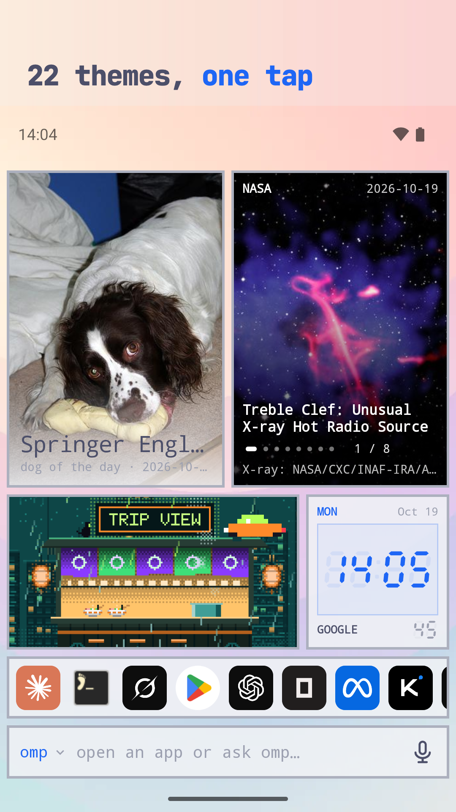
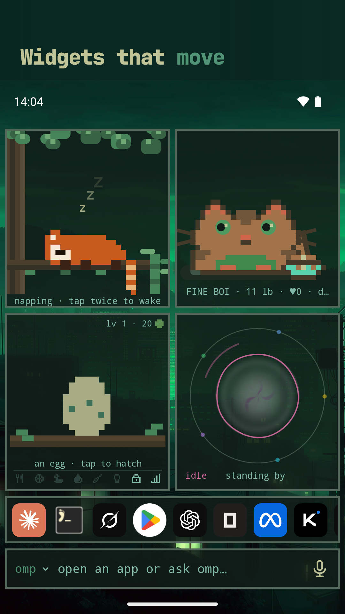

# Omalauncher

An Android home screen with the look of [Omarchy](https://omarchy.org), and an
optional Arch Linux ARM system next to your phone apps. Omalauncher runs the
system under proot, without root, and is its Wayland compositor: every Linux
window opens as its own Android task, with its own card in Recents.

<a href="https://play.google.com/store/apps/details?id=dev.omalauncher"></a>


<p>
  
  
  
  
</p>

- **Themes**: all 22 Omarchy themes, with their wallpapers, applied to the
  launcher and to the Linux apps, plus the community themes from
  [omarchy.org/themes](https://omarchy.org/themes/), or your own in
  `~/.config/omarchy/themes`
- **Widgets** written in OWL, a small declarative language you can edit on the
  phone, plus a [widget store](https://github.com/SimonSchubert/omarchy-widgets)
- **Linux, optional**: pacman and the AUR, Linux apps in their own windows,
  terminal widgets, a file manager, and opt-in GPU acceleration on Mali and Adreno 6xx+ GPUs
- **Coding agents**: the bar at the bottom sends a prompt to Claude Code, Codex,
  Copilot, opencode and others, which open in a terminal
- No account, no ads, no tracking

Needs an arm64 phone with Android 10 or newer. Without Linux, the launcher still
has the themes, wallpapers, Android apps and the widgets that don't run commands.

## Using it

Swipe up on home to browse the app drawer without opening the keyboard. Swipe down to open search and the agent prompt with the keyboard. Settings › gestures sets either swipe to the app drawer, search, or nothing, and swiping down can pull down the notification shade instead.

Home's bottom holds a dock of up to five apps (long-press an app › add to dock, select several and add them, or drag an app from home onto it; drag a dock app up onto home to move it out) and, optionally above it (style › pill), a pill that does what swiping down does: search, notifications or apps. The prompt bar appears with the app panel. Settings › style › home screen shows or hides apps' names on home, switches the strip between the dock, recent apps and nothing, sets the dock boxed or bare and small or large, shows or hides the pill, keeps the prompt bar on home, and sets the grid's rows (9 by default, or auto; tiles below the last row move up or to the next page).

The drawer can sort by name, most used or newest, with a letter rail to jump through it, a row of the apps used most, and a dot on apps just installed. Settings › style › app drawer also sets its columns, icon size, names, headings or one list, and how much of home shows through it, blurred or not. Long-press an app for **customize**: your own name and icon for it (on home and in the dock too) and a drawer group, your own section above the lists. Drag an app from the drawer straight onto home or the dock. Hidden apps can be locked behind the fingerprint.

Long-press an app in the drawer to hide it or to select several, then add them all to home or hide them together. Hidden apps leave the drawer, search and the recent apps strip (the dock keeps the apps you put in it); the drawer's show hidden switch lists them again, dimmed, to unhide.

The bar: the one input at the bottom of the home screen opens apps and asks
coding agents. Focusing it opens the list of Linux and Android apps; typing
narrows the list, and Enter opens the highlighted app or sends the text to the
agent. Short queries that name an app open it, sentences go to the agent; Tab
and the arrow keys move the highlight. Tap the agent's name to pick another
installed one; the choice is saved in `~/.config/omalauncher/agent`. Hold the mic to talk and release to send, or tap it to dictate
into the field. Speech is recognized by Android (on the device when the phone
supports it), so only text reaches Linux.

Long-press empty home space to see **running windows**. Each live Linux window
has its current title and a distinct number; tap it to return to that window,
even if its Android Recents card is missing. This does not start another app
or terminal session. Embedded terminal widgets are not listed. Windows whose
Linux app has exited cannot be recovered this way.

Touch input in Linux windows: tap is a left click, long press is a right
click, drag scrolls; apps with touch support (foot, GTK) get real touch.
Tern has a dedicated mapping: drag to scroll, pinch to change font size, and
hold then drag to select text. For adjacent tabs, start a horizontal swipe just
inside either side of the window (24–56 dp from the edge); swipe left for next
or right for previous. The outer Android-back edges stay reserved. This uses
Tern's default keyboard bindings; remapped shortcuts may change these actions.

Hardware keyboard shortcuts: Super+Enter (terminal), Super+Space or
Super+A (the bar), Super+1..9 (home pages) on the home screen; Super+Enter
and Super+W (close) in Linux windows.

The keys above the soft keyboard in terminals are the widgets folder's
`keybar.owl`, which you or an agent can change (its `docs/keybar.md`).
This phone build also reads `terminal.extra-keys` in
`~/.config/omalauncher/style/style.toml`, in Termux's extra-keys format; while
it's set, its keys stand in for keybar.owl's, in settings › style's terminal key
bar gaps and border width:

```toml
[terminal]
extra-keys = '[[ESC, TAB, CTRL, ALT, {key: LEFT, popup: {macro: "ALT b", display: "word"}}, DOWN, UP, RIGHT], [/, -, HOME, END, PGUP, PGDN, PASTE]]'
```

For coding agents, a layout with dedicated multiline, reverse-tab and word
navigation keys avoids having to latch a modifier for each command:

```toml
[terminal]
extra-keys = '[[ESC, CTRL, ALT, SHIFT, {macro: "SHIFT ENTER", display: "S↵"}, {macro: "SHIFT TAB", display: "S⇤"}, {macro: "ALT b", display: "←word"}, {macro: "ALT f", display: "word→"}], [TAB, ENTER, LEFT, RIGHT, UP, DOWN, BKSP, PASTE]]'
```

The shortcuts send real key chords, not typed escape characters. Shift+Enter
needs the terminal and application to support modified Enter (foot and coding
agents supporting the Kitty keyboard protocol do); Alt+B and Alt+F move by
words in readline-style shells and in Pi's editor. The plain Tab, Enter and
arrow keys remain available in the second row.

Tap ctrl, alt or shift for the next key, or hold it to lock it; modifier
keys show NEXT or LOCK, and the next key shows its active chord (⌃/⌥/⇧).
Swipe a key up and release to send its popup, with the chosen action shown
on the keycap and a brief confirmation after release. Dragging off to the
side cancels the gesture. A key with a popup doesn't repeat. A physical
keyboard key with a one-shot modifier sends one complete chord per press;
holding it won't accidentally type unmodified repeated characters.

A macro sends keys in order, each with the modifiers named before it:
`CTRL f d` is Ctrl+F, then D. An escaped `\n` in a macro sends Enter
(for example, `":wq\n"` sends the Vim save-and-quit command).
The named Termux keys BACKSLASH, QUOTE and APOSTROPHE produce their characters.
For reverse tab use BACKTAB (also BTAB, SHIFTTAB, or ISO_LEFT_TAB), a
"SHIFT TAB" macro, or the "ESC [ Z" macro; these send native Shift+Tab
rather than typing an escape sequence. Quoted \033[Z, \e[Z, and \u001b[Z
spellings are supported too, including double-backslash forms. Unrecognized
backslash escapes are preserved, not silently stripped. Up to three rows of
ten; '[]' hides the bar. Termux's own
actions (KEYBOARD, DRAWER) aren't keys here, and what can't be read shows in
the banner on home while the last good layout stays.

This phone build keeps its settings on a [Feather](https://github.com/t1nk333r/feather)
server (its device backups, plan 088): settings › backup. Paste a token of
kind *device backups only*, limited to `dev.omalauncher`; then back up now or
daily on Wi-Fi, and restore any of this launcher's backups there: this phone's,
an earlier install's or another phone's. A backup holds home and its pages,
widgets and their saved values, the dock, drawer groups, hidden apps, app names
and icons, gestures, style, and your own themes and backgrounds. It never holds
Linux, a widget's secrets or Android widget IDs: enter secrets and add Android
widgets again after a restore. A restore backs the phone up first, then
restarts the launcher and puts the backup in place as it starts.

## Building

```sh
./scripts/fetch-proot.sh          # Termux's proot -> app/src/main/jniLibs (needs bsdtar)
./gradlew :app:installDebug
# optional: skip the 830 MB download on the device
adb push ArchLinuxARM-aarch64-latest.tar.gz ArchLinuxARM-aarch64-latest.tar.gz.sig /sdcard/Android/data/dev.omalauncher/files/
```

Linux images are downloaded over HTTPS and verified against Arch Linux ARM's pinned signing key before extraction. An ADB-supplied image also needs its matching `.tar.gz.sig`. Existing Linux installations are unchanged. See [Linux download verification](docs/LINUX_DOWNLOAD_VERIFICATION.md).

Tests: `./gradlew $(scripts/affected-tests.py)` runs the unit tests a change can
affect, from where the branch left its upstream to the working tree (`--base <ref>`
starts elsewhere; it prints what it picked and why). It runs none when nothing they
use changed, and all of them when a build file did. `./gradlew :owl:test
:app:testDebugUnitTest` runs every test. `./gradlew :owl:owlJar`
builds `owl/build/cli/owl.jar`, the checker the widget store's CI runs.

Window recovery has Android device tests:
`./gradlew :app:connectedDebugAndroidTest -Pandroid.testInstrumentationRunnerArguments.class=dev.omalauncher.WindowRecoveryTest`.
Use a disposable development install/device, not an install holding live work.

In debug builds you can launch guest commands with
`adb shell am start -n dev.omalauncher/.MainActivity --es exec foot`.

- [docs/ARCHITECTURE.md](docs/ARCHITECTURE.md): the compositor, rendering, GPU
  acceleration, and how updates reach existing installs
- [docs/RELEASING.md](docs/RELEASING.md): Play releases and store assets
- [app/src/main/assets/widgets/README.md](app/src/main/assets/widgets/README.md):
  the widget language

## Layout

- `app/`: the Android app (Kotlin, Jetpack Compose, and the JNI bridge in `src/main/cpp`)
- `owl/`: the widget language and the `owl` command line, plain Kotlin
- `art/`: SVG masters for the app, agent and store icons
- `store/`: Play listing sources (screenshot frames, privacy policy)
- `fastlane/`: the Play listing and the upload lanes
- `scripts/`: fetching proot and theme colors, rendering icons, screenshots and widget previews

## License

MIT, see [LICENSE](LICENSE), for Omalauncher's own code and artwork. The
coding agents' logos, the symbol font and Omarchy's theme colors are not
covered; [THIRD_PARTY.md](THIRD_PARTY.md) lists them with their sources and
licenses. The app also ships proot, talloc and libandroid-shmem (GPL-2.0,
LGPL-3.0 and BSD-3-Clause, prebuilt by Termux), listed in the app under
settings › licenses.

Omalauncher is an independent project and is not affiliated with or endorsed
by Omarchy, Arch Linux, or the makers of the coding agents it installs.
